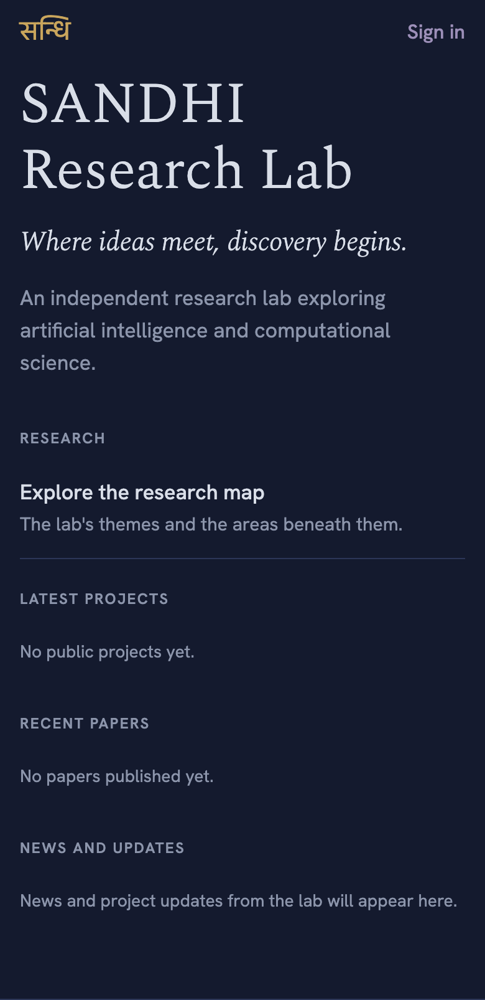
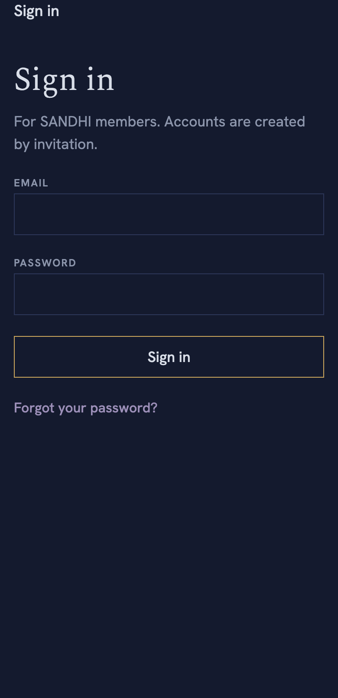

# SANDHI app

The Android app for [SANDHI Research Lab](https://sandhiresearch.org). The iOS
version is built and tested on iPhone and comes to the App Store after funding.
It is a client of the website, not a second system: the same accounts, the
same data, the same permissions, read through the site's `/api/v1`
([API reference](https://github.com/asifuddin01/Sandhi/blob/main/docs/mobile/API.md),
[app notes](https://github.com/asifuddin01/Sandhi/blob/main/docs/mobile/APP.md)).

Built with Expo (SDK 57) and Expo Router.

**Install:** [sandhiresearch.org/app](https://sandhiresearch.org/app), or the
APK from the [latest release](https://github.com/asifuddin01/sandhi-app/releases/latest).
Android 7.0 or later.

<p>
  
  
  
  
</p>

## What it does today

The public lab: home with news and project updates, research themes and
areas, projects and their published progress, papers (with search), people,
news, events, research notes, and site-wide search.

Members sign in with their SANDHI account: password, then a two-factor code or
a backup code. The session token lives in the device keychain. "Your account"
shows their announcements, projects, and documents. Joining, event
registration, and account settings open the website.

## Run it on your phone

```bash
npm install
npx expo start
```

Install **Expo Go** from the App Store or Play Store and scan the QR code. The
phone and this computer must be on the same Wi-Fi (or run
`npx expo start --tunnel`).

The app reads from the live site. To point it elsewhere:

```bash
EXPO_PUBLIC_API_URL=http://192.168.1.10:3000 npx expo start
```

## Checks

```bash
npx tsc --noEmit
npx expo lint
node --test src/lib/logic.test.ts
```

## Releasing (Android)

1. Raise `version` and `android.versionCode` in `app.json`.
2. `npx eas-cli@latest build --platform android --profile production` builds a
   signed APK on EAS (only for phone processors, so it stays small).
3. Attach the APK to a GitHub release, then enter its address, size, and
   SHA-256 under the website's Admin → Settings → SANDHI app.

Raising "Minimum supported version" there makes older installs show "Get the
new version" instead of loading.

## Layout

- `src/app/` — screens (Expo Router: every file is a route). `(tabs)/` holds
  the five tabs; the rest push on top of them.
- `src/lib/api.ts` — the one place requests are made: the base URL, the
  `X-Sandhi-Client` header the site uses for update checks, and the envelope.
- `src/lib/session.tsx` — sign-in, two-factor, and sign-out; the token is kept
  with `expo-secure-store`.
- `src/components/ui.tsx` — text styles, rows, and the loading and error
  states every screen shares.
- `src/constants/theme.ts` — the website's palettes and fonts.
